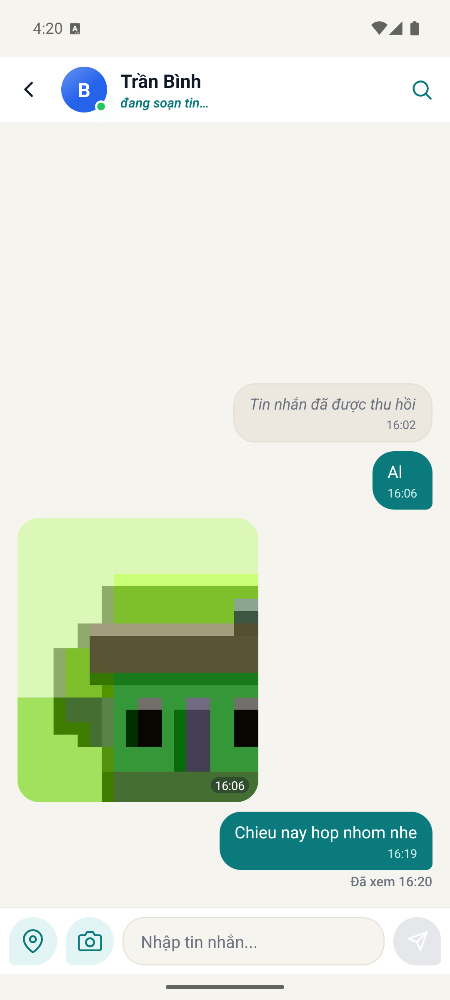
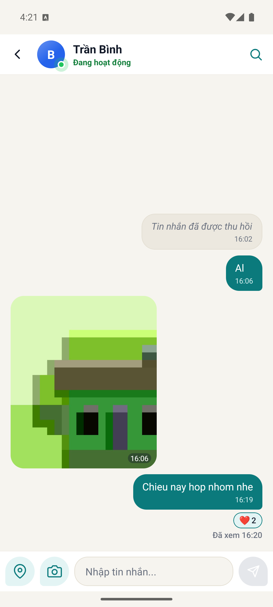
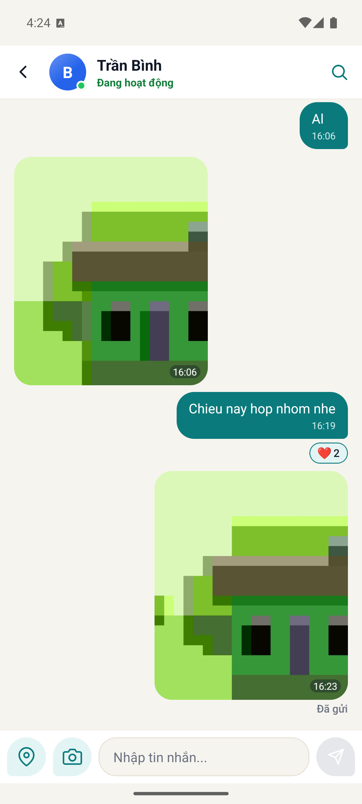
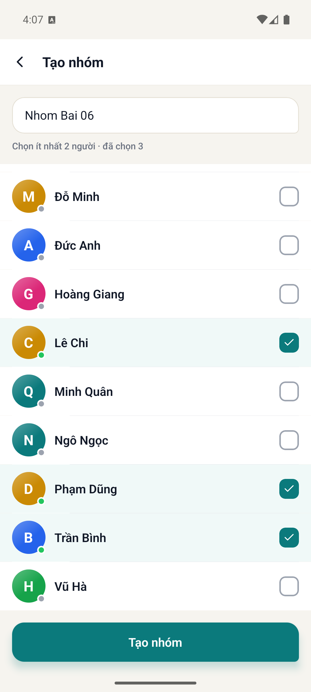
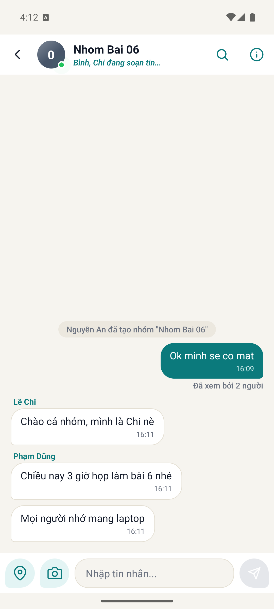
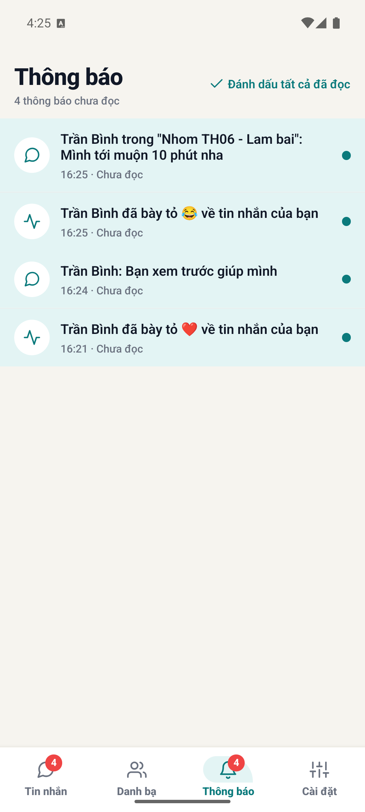

# Bài thực hành 06 - Chat nâng cao với Firebase và Cloudinary (React Native)

Em chào thầy, em là **Phạm Đức Anh**, sinh viên PTIT ngành Công nghệ phần mềm, mã học phần RIPT1412-20261-02. Em xin gửi thầy bài thực hành 06.

Trong bài này, em phát triển tiếp app chat của Bài 5 (React Native CLI 0.87, TypeScript, Firebase JS SDK 13, React Navigation 7). Em bổ sung chat nhóm, gửi ảnh, trạng thái "đang soạn tin" và "đã xem", thu hồi tin và cảm xúc. Màn Thông báo em chuyển sang dữ liệu thật, và em làm thêm 5 mục nâng cao của Phần C.

- Em dùng dự án Firebase riêng: `chat-nang-cao-th06` (Realtime Database ở `asia-southeast1`). Bài 5 dùng dự án khác nên không bị ảnh hưởng.
- Cloudinary: cloud `cdzfxgll`, unsigned preset `chat_th06_unsigned`, ảnh lưu trong thư mục `chat-th06`.
- Quy ước giao diện em ghi trong `DESIGN.md`. Báo cáo luật bảo mật (Word, 1 trang): [`docs/bao-cao-security-rules-bai06.docx`](docs/bao-cao-security-rules-bai06.docx).

## Chức năng theo đề

| Mục | Nội dung | Vị trí mã |
|---|---|---|
| A1. Trạng thái trong chat | "đang soạn tin…" tự tắt sau 3 giây, khi gửi và khi rời màn hình; "Đã gửi" / "Đã xem HH:mm" (nhóm: "Đã xem bởi N người"); "Hoạt động X phút trước"; `onDisconnect()` cho typing và online | `hooks/useTypingSignal.ts`, `services/typingService.ts`, `presenceService.ts`, `ChatHeader.tsx`, `ChatDetailScreen.tsx` |
| A2. Thu hồi và cảm xúc | Nhấn giữ: Sao chép, Thu hồi (tin của mình), 👍 ❤️ 😂 😮 😢. Thu hồi ghi `recalled: true`, không xoá node; tin cuối bị thu hồi thì Home cũng đổi. Cảm xúc gom theo emoji kèm số lượng | `MessageActionsSheet.tsx`, `ReactionSummary.tsx`, `chatService.recallMessage/toggleReaction` |
| A3. Gửi ảnh | Nút 📷: chụp ảnh hoặc chọn thư viện, xin quyền camera, thu nhỏ cạnh dài ≤ 1024px, upload unsigned lên Cloudinary, chỉ lưu URL. Bong bóng tạm có loading và nút "Thử lại"; nhấn ảnh xem toàn màn hình; Home hiện "📷 Hình ảnh" / "📍 Vị trí" | `services/uploadService.ts`, `imagePickerService.ts`, `PendingImageBubble.tsx`, `ImageViewerModal.tsx` |
| A4. Chat nhóm | Màn Tạo nhóm (tên + chọn ≥ 2 người), tên người gửi trên bong bóng, tiêu đề "N đang online", Home gộp 1-1 và nhóm theo tin mới nhất, số chưa đọc riêng từng người; nhóm gửi được chữ, vị trí, ảnh | `features/groups/CreateGroupScreen.tsx`, `services/groupService.ts`, `HomeScreen.tsx` |
| A5. Thông báo thật | `notifications/{uid}` khi có tin mới (gộp một thông báo cho mỗi cuộc trò chuyện, bỏ qua người đang mở chat đó), khi được thêm vào nhóm, khi có người thả cảm xúc. Badge tab, nhấn để mở đúng chat, "Đánh dấu tất cả đã đọc" | `services/notificationService.ts`, `context/NotificationContext.tsx`, `NotificationsScreen.tsx` |
| B. Kỹ thuật | Tin + `lastMessage` + `unread` trong **một** `update()` nhiều đường dẫn, `increment(1)`; tải theo trang `limitToLast(20)` + `endBefore`; code Firebase/Cloudinary trong `src/services/`; huỷ mọi listener trong cleanup; không có API secret | `services/*`, `database.rules.json` |
| C1. Quản trị nhóm | Đổi tên, thêm/xoá thành viên (trưởng nhóm), rời nhóm; mỗi thao tác có tin hệ thống | `features/groups/GroupInfoScreen.tsx`, `groupService.ts` |
| C2. Trả lời trích dẫn | "Trả lời" trong menu nhấn giữ; nhấn trích dẫn thì tải thêm trang (nếu cần) và cuộn tới tin gốc | `ReplyPreview.tsx`, `MessageBubble.tsx`, `ChatDetailScreen.tsx` |
| C3. Hồ sơ cá nhân | Đổi họ tên và ảnh đại diện (Cloudinary), cập nhật ngay ở Danh bạ, Home, Chat | `features/settings/EditProfileScreen.tsx`, `userService.updateProfile`, `Avatar.tsx` |
| C4. Thông báo cục bộ | `@notifee/react-native`: app ở nền mà có thông báo mới thì hiện thông báo hệ thống, nhấn vào mở đúng chat | `services/localNotificationService.ts`, `index.js`, `NotificationContext.tsx` |
| C5. Tìm tin nhắn | Ô tìm trong tiêu đề chat, không phân biệt dấu và hoa thường ("xin chao" ra "Xin chào"), nhấn kết quả để cuộn tới tin | `MessageSearchBar.tsx`, `utils/textSearch.ts` |

## Cấu trúc Realtime Database

```text
users/{uid}                  { name, avatarUrl? }
status/{uid}                 { online, lastChanged }
conversations/{convId}       { type: "direct"|"group", name?, members: {uid: true}, createdBy, createdAt }
messages/{convId}/{msgId}    { senderId, type: "text"|"image"|"location"|"system", text?, imageUrl?, lat?, lng?,
                               createdAt, recalled?, reactions?: {uid: emoji}, replyTo?: {id, senderId, preview} }
userChats/{uid}/{convId}     { lastMessage, lastType, lastSenderId, lastMessageId, updatedAt, unread }
readStatus/{convId}/{uid}    thời điểm đọc cuối
typing/{convId}/{uid}        true
activeConv/{uid}             convId đang mở (để không tạo thông báo cho người đang xem)
notifications/{uid}/{id}     { type: "message"|"group_added"|"reaction", convId, fromUid, text, createdAt, read }
```

- Chat 1-1 dùng mã cố định `sort(uidA, uidB).join('_')`; lần đầu mở chat thì tạo `conversations/{id}`. Nhóm dùng mã `push()`.
- Thông báo tin mới có id cố định `msg_{convId}`: tin sau ghi đè nội dung và đặt lại `read: false`, nên mỗi cuộc trò chuyện chỉ có một thông báo.

## Cấu hình Firebase

Nếu thầy muốn chạy trên một dự án Firebase khác, thầy làm theo các bước sau:

1. Tạo dự án trên [Firebase Console](https://console.firebase.google.com), thêm một **Web app** và chép đoạn cấu hình.
2. **Authentication → Sign-in method**: bật **Email/Password**.
3. **Realtime Database → Create database** (chọn khu vực, ví dụ `asia-southeast1`).
4. Dán cấu hình vào `src/services/firebase.ts` (nhớ có `databaseURL`). Đây là cấu hình công khai của Web app; dữ liệu được bảo vệ bằng Authentication và Rules.
5. Sửa `.firebaserc` thành mã dự án của thầy, rồi deploy luật:

```sh
npx firebase-tools login
npx firebase-tools deploy --only database --project chat-nang-cao-th06
```

## Cấu hình Cloudinary

1. Đăng nhập [Cloudinary](https://console.cloudinary.com), ghi lại **Cloud name**.
2. **Settings → Upload → Upload presets → Add upload preset**: Signing mode **Unsigned**, asset folder `chat-th06`.
3. Sửa `src/config/cloudinary.ts`: `cloudName` và `uploadPreset`.

Em upload ảnh bằng `fetch` multipart tới `https://api.cloudinary.com/v1_1/{cloudName}/image/upload` kèm `upload_preset`. Em **không dùng và không lưu API key hay API secret** trong mã nguồn.

## Chạy ứng dụng

Để chạy app, thầy cần Node 22.11 trở lên và Android Studio có máy ảo (nên dùng image có Google Play).

```sh
npm install
npm start
# terminal khác, máy ảo đang bật
npm run android
```

Bài này có thêm gói native (`react-native-image-picker`, `@react-native-clipboard/clipboard`, `@notifee/react-native`), nên thầy cần build lại bằng `npm run android`; chỉ reload Metro là không đủ.

Nếu thầy chạy nhiều máy ảo: bật từng máy (`emulator -avd <tên>`), rồi với mỗi máy chạy `adb -s <serial> reverse tcp:8081 tcp:8081` và `npm run android -- --device <serial>`. Máy ảo không có GPS thật, nên thầy đặt toạ độ trước khi gửi vị trí: `adb -s <serial> emu geo fix 105.792206 21.046461`.

Tài khoản thử: thầy có thể dùng các tài khoản mẫu em đã đăng ký trên dự án, mỗi máy ảo một tài khoản, hoặc đăng ký thêm ở màn Đăng ký.

## Kiểm tra mã

```sh
npx tsc --noEmit
npx eslint src __tests__ App.tsx index.js
npm test
```

`npm test` chạy bài kiểm tra render cơ bản; `jest.setup.js` giả lập Firebase, các service và các gói native để không mở kết nối mạng. (Thư mục `component/` là bài tập cũ của em, không thuộc app.)

## Minh chứng

Em chụp ảnh từ máy ảo Android 16 (Pixel 7: Nguyễn An, Pixel 8 Pro: Trần Bình) và lưu trong `docs/screenshots/bai06/`. Kết quả kiểm thử chi tiết em để trong [`docs/bao-cao-kiem-thu-bai06.md`](docs/bao-cao-kiem-thu-bai06.md).

| Đang soạn tin và Đã xem | Thu hồi và cảm xúc | Tin ảnh |
|---|---|---|
|  |  |  |

| Tạo nhóm | Chat nhóm có tên người gửi | Thông báo có badge |
|---|---|---|
|  |  |  |

Ảnh bổ sung:
- Gửi ảnh: lỗi mạng có nút "Thử lại" (`03a`), đang gửi (`03c`), xem toàn màn hình (`03b`).
- Thông báo: đánh dấu tất cả đã đọc (`06b`).
- Quản trị nhóm có tin hệ thống (`07`), màn Thông tin nhóm (`08`).
- Menu nhấn giữ (`09`), tìm kiếm không dấu (`10`), thông báo hệ thống notifee (`11`).
- Thao tác trái phép bị từ chối với lỗi `PERMISSION_DENIED` (`12`).

Ảnh Firebase Console (tab Data với `conversations` và `userChats`, tab Rules) em chụp bổ sung. Bằng chứng `PERMISSION_DENIED` nằm trong [báo cáo luật (Word)](docs/bao-cao-security-rules-bai06.docx).

## Giới hạn đã biết

Em xin nêu một số giới hạn của bài:

- Thông báo cục bộ (notifee) chỉ hiện khi tiến trình app còn sống ở nền. Em không dùng FCM và Cloud Functions (gói Spark), nên app bị tắt hẳn thì không nhận được. Để nhận được thông báo khi ở nền, app ghi trạng thái offline sau 5 giây ở nền nhưng vẫn giữ kết nối, thay vì ngắt kết nối như Bài 5.
- Rules không đếm được số phần tử, nên "nhóm tối thiểu 3 người" em kiểm tra ở app (màn Tạo nhóm), không kiểm tra trong rules.
- `activeConv` được đọc ngay trước khi gửi, nên có thể lệch nếu người nhận vừa rời màn hình đúng lúc đó.
- Tìm kiếm tải toàn bộ tin của một cuộc trò chuyện một lần; cách này phù hợp với quy mô bài thực hành.
- Em chưa build và kiểm tra trên iOS.

Em cảm ơn thầy đã đọc bài.
